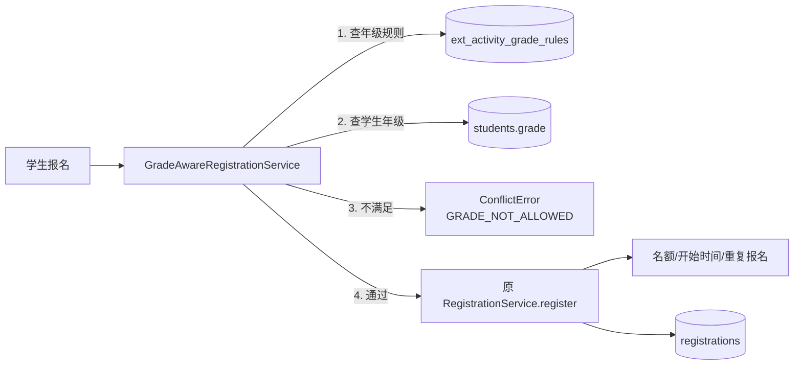

# CR-01 年级限定报名 — 需求变更与设计说明

| 项 | 内容 |
|---|---|
| 变更编号 | CR-01（教师隐藏变更单） |
| 基线 | 实验二初始版本 `baseline-v1` |
| 日期 | 2026-11-26 |
| 约束 | **不修改 `project/`、`frontend/src/`、`run.py` 等任何既有文件**；只新增代码与文档 |
| 交付 | 新分支 `feature/cr01-grade-limit` → 合并 `main` → 部署 |

---

## 1. 需求变更

### 1.1 背景
学校新增仅面向大二、大三学生的活动类别，需要在报名环节按年级限制。

### 1.2 规则

| 编号 | 规则 |
|---|---|
| R1 | 活动支持「年级限定直接报名」 |
| R2 | 学生新增 `grade` 字段，取值 1–4（大一至大四） |
| R3 | 只有 `grade ∈ {2,3}` 的学生可报名该类活动 |
| R4 | 其他年级报名必须**明确提示原因**（不能只返回通用错误） |
| R5 | 该规则仍受名额上限、活动开始时间、重复报名等公共约束 |
| R6 | 原有「直接报名」「审核报名」的行为不得改变 |

### 1.3 验收标准

| 编号 | 场景 | 期望 |
|---|---|---|
| CR1-01 | 大二学生报名年级限定活动 | 通过 |
| CR1-02 | 大三学生报名年级限定活动 | 通过 |
| CR1-03 | 大一学生报名 | 拒绝并显示原因 |
| CR1-04 | 大四学生报名 | 拒绝并显示原因 |
| CR1-05 | 变更后重跑 C1–C10 | 全部保持通过 |

---

## 2. 设计

### 2.1 方案对比

| 方案 | 说明 | 结论 |
|---|---|---|
| A 新增 `PolicyType.GRADE_LIMITED` | 在策略枚举里加第三种类型 | **否决**：需改枚举、数据库 CHECK 约束、前端类型判断，破坏"零修改"且把"年级"和"报名方式"耦合在一起 |
| B 新增独立策略类，仍用 `policy_type` 选择 | 策略工厂只按 `policy_type` 选实现，无法同时表达"直接通过 + 年级限制" | **否决**：规则是叠加关系，不是互斥的第三种方式 |
| C 组合规则：活动保持 `DIRECT`，年级限制作为附加约束 | 新表存规则；在报名入口前置校验；活动与策略均不改 | **采用** |

### 2.2 结构



**校验顺序**：年级 → 原服务（名额 → 开始时间 → 重复）。年级不符时不会产生任何报名记录。

### 2.3 扩展点

| 扩展点 | 实现 | 说明 |
|---|---|---|
| 学籍年级 | `ALTER TABLE students ADD COLUMN grade INTEGER` | 只改库结构，不改实体类 |
| 活动规则 | 新表 `ext_activity_grade_rules(activity_id, min_grade, max_grade)` | 与活动一对一，删活动不级联（保留审计） |
| 报名拦截 | `GradeAwareRegistrationService(RegistrationService)` 覆写 `register()` | 调用 `super().register()` 复用全部公共规则 |
| 活动视图 | `GradeAwareActivityService(ActivityService)` 覆写 `list()/get()` | 返回值追加 `grade_rule` 字段，原前端忽略未知字段 |
| 接口 | `/api/ext/grade/*` | 原 `server.py` 只路由 `/api/` 前缀，故扩展接口放在该前缀下 |
| 页面 | `ext/pages/grade.html` | 独立页面，原 `dist` 不动 |

### 2.4 数据模型

```sql
ALTER TABLE students ADD COLUMN grade INTEGER;          -- 1..4

CREATE TABLE ext_activity_grade_rules (
  activity_id TEXT PRIMARY KEY,
  min_grade   INTEGER NOT NULL CHECK (min_grade BETWEEN 1 AND 4),
  max_grade   INTEGER NOT NULL CHECK (max_grade BETWEEN 1 AND 4),
  created_at  TEXT NOT NULL,
  updated_at  TEXT NOT NULL,
  CHECK (min_grade <= max_grade)
);
```

### 2.5 接口

| 方法 | 路径 | 权限 | 说明 |
|---|---|---|---|
| GET | `/api/ext/grade/rules` | 管理员 | 活动 + 规则 |
| PUT | `/api/ext/grade/rules/{id}` | 管理员 | 设置规则（仅直接报名型，否则 400） |
| DELETE | `/api/ext/grade/rules/{id}` | 管理员 | 取消限定 |
| GET | `/api/ext/grade/students` | 管理员 | 学生年级列表 |
| PUT | `/api/ext/grade/students/{id}` | 管理员 | 修改年级 |
| GET | `/api/ext/grade/me` | 登录用户 | 当前年级 |
| GET | `/api/ext/pages/grade.html` | 登录用户 | 配置页 |

---

## 3. 影响分析

| 项 | 结论 |
|---|---|
| 修改的既有文件 | **0**（`project/`、`frontend/src/`、`run.py`、`tools/` 的 diff 为空） |
| 新增文件 | `ext/{__init__,schema,rules,services,api,package_ext}.py`、`ext/pages/grade.html`、`ext/README.md`、`run_ext.py`、3 个测试文件 |
| 数据库 | 加 1 列 + 1 表，均为 `IF NOT EXISTS` / 先判断列，幂等 |
| 原有接口 | 响应**只增字段** `grade_rule`，不删不改；原前端忽略未知字段 |
| 原有行为 | 未配置规则的活动完全走原逻辑；审核型不允许配置规则 |
| 回归 | 原有 88 条 API 断言全部通过（CR1-05） |
| 部署 | 启动入口由 `run.py` 改为 `run_ext.py`（部署配置变更，非源码修改）；原入口仍可单独运行 |

### 风险与应对

| 风险 | 应对 |
|---|---|
| 年级未登记 | 返回 `GRADE_MISSING`，提示先登记，而不是默认放行 |
| 规则与活动生命周期 | 活动软删除后规则保留，不影响历史；恢复活动时规则仍生效 |
| 装配逻辑复制 | `run_ext.py` 复制了约 30 行装配；若原 `app.py` 变更需同步，已在文档标注 |
| 学生自行改年级 | 仅管理员接口可改，前端无学生入口 |

---

## 4. 需求 → 实现对照

| 规则 | 实现位置 |
|---|---|
| R1 活动支持年级限定 | `ext/schema.py` + `ext/api.py`（`PUT /api/ext/grade/rules/{id}`） |
| R2 学生 grade 1–4 | `students.grade` + `ext/rules.py:StudentGradeRepository` |
| R3 仅大二/大三可报 | `ext/services.py:GradeAwareRegistrationService.register` |
| R4 明确提示 | `ConflictError(code="GRADE_NOT_ALLOWED")`，消息含「仅限大二、大三报名（你的年级：大一）」 |
| R5 公共约束 | 前置校验后调用 `super().register()`，名额/时间/重复由原实现负责 |
| R6 原行为不变 | 未配置规则直接透传；审核型禁止配置规则 |

---

## 5. 验收结果

| 编号 | 结果 |
|---|---|
| CR1-01 大二通过 | 通过 |
| CR1-02 大三通过 | 通过 |
| CR1-03 大一拒绝 + 原因 | 通过（409 `GRADE_NOT_ALLOWED`） |
| CR1-04 大四拒绝 + 原因 | 通过 |
| CR1-05 C1–C10 回归 | 通过（88/88） |

补充边界（单元测试）：名额满、重复报名、活动已开始、规则取消后放行、年级修改后生效、未登记年级。
