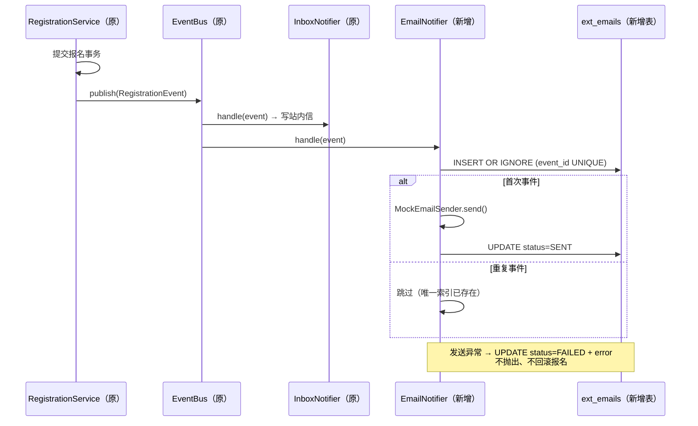

# CR-02 模拟邮件通知 — 需求变更与设计说明

| 项 | 内容 |
|---|---|
| 变更编号 | CR-02（教师隐藏变更单） |
| 基线 | 实验二初始版本 `baseline-v1`（含 CR-01） |
| 日期 | 2026-11-26 |
| 约束 | **不修改任何既有文件**；只新增代码与文档 |
| 交付 | 新分支 `feature/cr02-email` → 合并 `main` → 部署 |

---

## 1. 需求变更

### 1.1 背景
管理员希望在站内消息之外，同步向报名学生发送邮件。教学环境不接真实邮件服务器，用 `MockEmailSender` 模拟发送并记录。

### 1.2 规则

| 编号 | 规则 |
|---|---|
| R1 | 报名通过、审核通过、审核拒绝三类事件：**站内信保留**，同时新增模拟邮件 |
| R2 | 记录收件人、主题、内容、状态、时间 |
| R3 | 邮件发送失败必须记录错误，但**不得回滚**已成功提交的报名 |
| R4 | 同一业务事件不得重复发送两份相同邮件 |
| R5 | 通过观察者/事件结构实现，不把发信代码写进 `RegistrationService` |

### 1.3 验收标准

| 编号 | 场景 | 期望 |
|---|---|---|
| CR2-01 | 直接报名通过 | 站内消息与模拟邮件均有记录 |
| CR2-02 | 审核批准或拒绝 | 两个渠道记录对应结果 |
| CR2-03 | 模拟邮件发送失败 | 报名状态正确，错误有记录 |
| CR2-04 | 重复提交同一业务事件 | 不重复生成相同通知 |
| CR2-05 | 变更后重跑 C1–C10 | 原有功能保持通过 |

---

## 2. 设计

### 2.1 方案

在既有 `EventBus` 上**新增一个订阅者**，与站内信订阅者并列；业务服务完全无感。



### 2.2 触发范围

| 事件状态 | 是否发信 | 说明 |
|---|---|---|
| `APPROVED` | 是 | 直接报名通过 / 审核通过 / 候补自动补位（主题注明"补位"） |
| `REJECTED` | 是 | 审核拒绝 |
| `PENDING` | 否 | 待审核不需要通知 |
| `WAITLISTED` | 否 | 进入候补由站内信告知 |
| `CANCELLED` | 否 | 用户主动操作 |

### 2.3 去重与失败语义

- **去重**：`ext_emails.event_id` 唯一索引；订阅者先 `INSERT OR IGNORE` 占位（`SENDING`），`rowcount=0` 即重复，直接跳过。即使事件被重放多次，也只留一条记录、只发一封。
- **失败**：捕获所有异常 → `status=FAILED` + `error`；订阅者不向总线抛出，`EventBus` 自身也有兜底，因此报名事务不受影响。
- **独立性**：站内信与邮件互为独立订阅者，一方失败不影响另一方。

### 2.4 数据模型

```sql
CREATE TABLE ext_emails (
  id              INTEGER PRIMARY KEY AUTOINCREMENT,
  event_id        TEXT NOT NULL UNIQUE,
  registration_id TEXT NOT NULL,
  student_id      TEXT NOT NULL,
  to_addr         TEXT NOT NULL,
  subject         TEXT NOT NULL,
  body            TEXT NOT NULL,
  status          TEXT NOT NULL CHECK (status IN ('SENDING','SENT','FAILED')),
  error           TEXT,
  created_at      TEXT NOT NULL,
  sent_at         TEXT
);
```

收件人约定：`<student_id>@campus.edu.cn`（示例域，不真实投递）。

### 2.5 接口与页面

| 方法 | 路径 | 权限 | 说明 |
|---|---|---|---|
| GET | `/api/ext/emails?limit=50` | 管理员 | 最近记录 + 统计（SENT/FAILED/总数） |
| POST | `/api/ext/emails/fail-next` | 管理员 | 布置"下一次发送失败"，用于演示 CR2-03 |
| GET | `/api/ext/pages/emails.html` | 登录用户 | 邮件记录页（状态高亮、一键模拟失败） |

---

## 3. 影响分析

| 项 | 结论 |
|---|---|
| 修改的既有文件 | **0** |
| 新增文件 | `ext/email.py`、`ext/pages/emails.html`、表 `ext_emails`；`run_ext.py` 增加一次 `bus.subscribe` |
| 原有行为 | 事件总线、站内信、报名服务均未改动；只是多一个订阅者 |
| 数据库 | 新增 1 表，`IF NOT EXISTS`，幂等 |
| 回归 | C1–C10 全部通过（88/88），站内信行为不变 |
| 性能 | 每次事件多一次本地 SQLite 写，可忽略 |

### 风险与应对

| 风险 | 应对 |
|---|---|
| 邮件失败影响报名 | 订阅者内部捕获异常；`EventBus` 另有兜底 |
| 事件重放导致重复邮件 | `event_id` 唯一索引 + `INSERT OR IGNORE` |
| 记录表膨胀 | 页面按 `limit` 查询；后续可加归档（当前教学场景无需） |
| 收件人地址真实性 | 明确为模拟域，不接真实 SMTP，不产生外发流量 |

---

## 4. 需求 → 实现对照

| 规则 | 实现位置 |
|---|---|
| R1 双渠道 | `run_ext.py`：`bus.subscribe(InboxNotifier)` + `bus.subscribe(EmailNotifier)` |
| R2 记录字段 | `ext/email.py:EmailRepository.begin/mark_sent/mark_failed` + `ext_emails` 表 |
| R3 失败不回滚 | `EmailNotifier.handle` 捕获异常仅标记 `FAILED`；不向总线抛出 |
| R4 不重复 | `event_id` 唯一索引 + `INSERT OR IGNORE` |
| R5 观察者结构 | 新增 `EmailNotifier(EventSubscriber)`，未修改 `RegistrationService` |

---

## 5. 验收结果

| 编号 | 结果 |
|---|---|
| CR2-01 直接报名通过 | 通过（站内信 + 邮件 `SENT`，主题「报名结果通知：已通过」） |
| CR2-02 审核批准/拒绝 | 通过（通过、未通过两类主题） |
| CR2-03 模拟发送失败 | 通过（邮件 `FAILED` 且记录错误；报名 `APPROVED`，统计 `approved=1`） |
| CR2-04 重复事件 | 通过（同一 `event_id` 仅一条记录） |
| CR2-05 C1–C10 回归 | 通过（88/88） |

补充边界（单元测试）：待审核不发信、失败后下一次自动恢复、统计计数正确。
