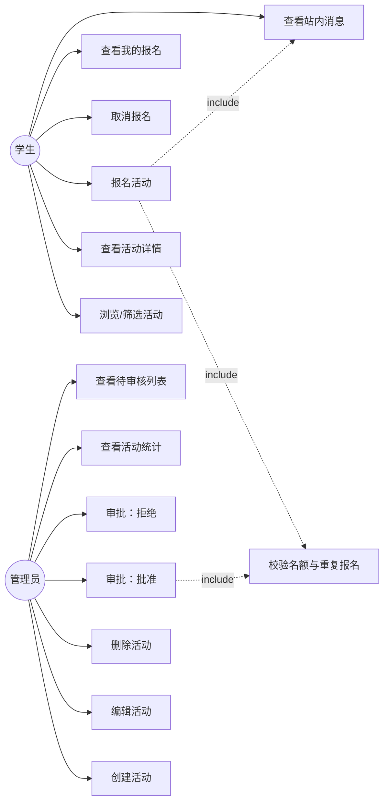

# CampusEvent 用例说明

| 项 | 值 |
|---|---|
| 版本 | v1.0（对应 `baseline-v1`） |
| 关联文档 | `docs/srs.md` |
| 编写 | <姓名> <学号> <班级>（待填写） |

---

## 1. 用例图（文字化 + Mermaid）

> 说明：`UC14` 是被两类报名与审批共同复用的**公共规则**（名额、重复有效报名），在设计中落在服务层而非策略里。

## 2. 用例清单

| 编号 | 用例 | 参与者 | 关联需求 | 优先级 |
|---|---|---|---|---|
| UC01 | 浏览/筛选活动 | 学生 | P2-F02 | 高 |
| UC02 | 查看活动详情 | 学生 | P2-F02 | 高 |
| UC03 | 报名活动 | 学生 | P2-F03、F04 | 高 |
| UC04 | 取消报名 | 学生 | P2-F03 | 高 |
| UC05 | 查看我的报名 | 学生 | P2-F03、F06 | 中 |
| UC06 | 查看站内消息 | 学生 | P2-F07 | 高 |
| UC07 | 创建活动 | 管理员 | P2-F01 | 高 |
| UC08 | 编辑活动 | 管理员 | P2-F01 | 中 |
| UC09 | 删除活动 | 管理员 | P2-F01、BR7 | 中 |
| UC10 | 审批：批准 | 管理员 | P2-F05、BR2、BR3 | 高 |
| UC11 | 审批：拒绝 | 管理员 | P2-F05 | 高 |
| UC12 | 查看活动统计 | 管理员 | P2-F08 | 中 |
| UC13 | 查看待审核列表 | 管理员 | P2-F05 | 高 |
| UC14 | 公共校验（名额/重复） | 系统 | BR3、BR4、BR5 | 高 |

---

## 3. 详细用例

### UC03 报名活动

| 项 | 内容 |
|---|---|
| 参与者 | 学生（主要） |
| 目标 | 学生对某活动成功产生一条有效报名，并收到站内通知 |
| 前置条件 | 已以学生身份登录；活动存在且未被删除；活动尚未开始 |
| 触发 | 学生在活动详情页点击「报名」 |
| 关联规则 | BR1、BR2、BR3、BR4、BR5、BR6 |

**主成功流程（直接报名型）**
1. 系统校验：活动存在、未删除、未开始。
2. 系统执行公共校验：该学生对该活动无「待审核」或「已通过」报名。
3. 系统检查剩余名额（容量 − 已通过数）> 0。
4. 系统按活动策略 `DIRECT` 创建状态为 `APPROVED` 的报名记录。
5. 系统提交事务，发布「报名已通过」领域事件。
6. 通知订阅者写入站内消息。
7. 系统返回报名详情，页面显示「已通过」。

**备选流程 A（审核型）**
- 4a. 策略为 `REVIEW`：创建状态为 `PENDING` 的记录，**不占用名额**。
- 5a. 发布「报名待审核」事件；6a. 写入「已提交，等待审核」消息。
- 页面显示「待审核」。

**异常流程**
- E1 活动不存在/已删除 → 返回 404，提示「活动不存在或已下架」。
- E2 活动已开始 → 返回 409，提示「活动已开始，无法报名」（BR5）。
- E3 已存在有效报名 → 返回 409，提示「你已报名该活动」（BR4）。
- E4 名额已满（直接型）→ 返回 409，提示「名额已满」。
- E5 通知写入失败 → 报名**不回滚**，写 `notify_failures` 留痕，接口仍返回成功（BR6）。

**后置条件**
- 成功：存在 1 条新报名；若通过则已通过数 +1；消息列表新增 1 条。
- 失败：无任何数据变更（E5 除外，仅多一条失败记录）。

---

### UC10 审批：批准

| 项 | 内容 |
|---|---|
| 参与者 | 管理员（主要） |
| 目标 | 把一条待审核报名转为已通过，且不突破人数上限 |
| 前置条件 | 已以管理员身份登录；目标报名存在且状态为 `PENDING` |
| 触发 | 管理员在待审核列表点击「批准」 |
| 关联规则 | BR2、BR3、BR6 |

**主成功流程**
1. 系统校验报名存在且状态为 `PENDING`。
2. 系统**再次**检查该活动剩余名额 > 0。
3. 系统将状态改为 `APPROVED`，更新 `updated_at`。
4. 提交事务，发布「审核通过」事件。
5. 写入站内消息「你报名的活动已通过审核」。
6. 返回更新后的报名与最新统计。

**异常流程**
- E1 报名不存在 → 404。
- E2 状态不是 `PENDING`（如已被取消/已拒绝）→ 409，提示「该申请状态已变更，请刷新」。
- E3 名额已满 → 409，提示「名额已满，无法批准」，状态保持 `PENDING`（BR3）。
- E4 通知失败 → 状态仍为 `APPROVED`，留痕（BR6）。

**后置条件**
- 成功：状态 `APPROVED`；已通过数 +1；待审核数 −1；消息 +1。

---

### UC09 删除活动

| 项 | 内容 |
|---|---|
| 参与者 | 管理员 |
| 目标 | 让活动从列表与详情中消失，同时保留历史报名与消息 |
| 前置条件 | 已登录为管理员；活动存在且未删除 |
| 关联规则 | BR7 |

**主成功流程**
1. 系统将 `activities.deleted_at` 置为当前时间（**软删除**）。
2. 活动不再出现在列表/详情；不可再报名。
3. 已存在的报名与消息保持不变。
4. 返回成功与提示「已下架」。

**异常流程**
- E1 活动不存在或已删除 → 404。
- E2 重复删除 → 幂等返回成功。

**设计说明**
选择软删除而非「拒绝删除并提示」，理由：报名是已发生的业务事实，硬删会导致历史消息与统计断裂；软删除同时满足「不得报名」与「历史可追溯」。

---

## 4. 用例与验收用例映射

| 用例 | 验收用例 |
|---|---|
| UC07 创建活动 | C1 |
| UC03 报名（直接型） | C2、C4 |
| UC03 报名（重复） | C3 |
| UC03 报名（审核型） | C5 |
| UC10 批准 | C6、C8 |
| UC11 拒绝 | C7 |
| UC04 取消 | C9 |
| 全局持久化 | C10 |
